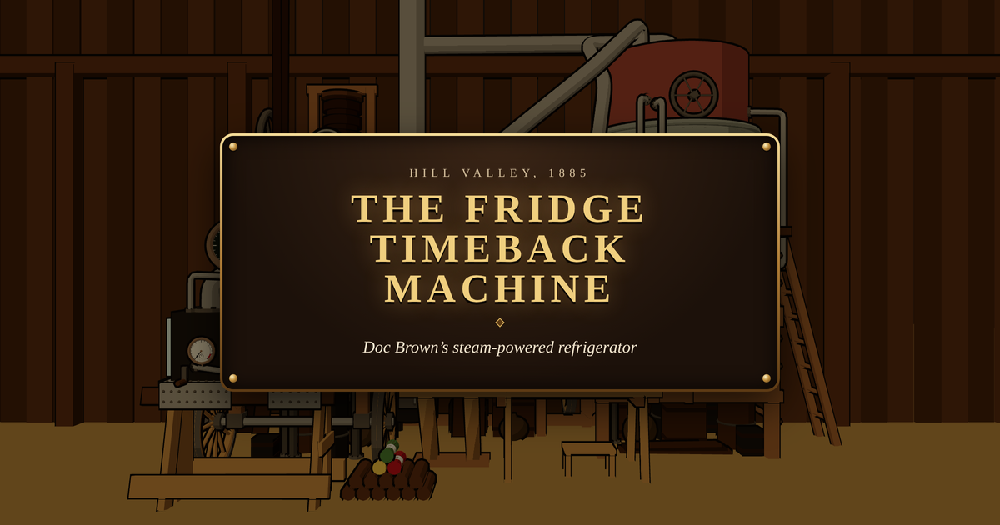

<h1 align="center">The Fridge Timeback Machine</h1>

<p align="center">
  <em>Hill Valley, 1885. Doc Brown's steam-powered refrigerator, rebuilt as an interactive, cell-shaded 3D scene.</em>
</p>

<p align="center">
  
</p>

In _Back to the Future Part III_, Doc builds a towering contraption of boilers, pipes and gauges in
a livery stable, all to make a single ice cube for his tea. Here it is, piece by piece, and it works:
stoke the stove, open the valves, climb the ladder, turn the crank "hard to the left!", and see what
comes out of the duct.

Doc's instructions guide you. You don't have to follow them. The machine has more than one way
to end, and a trophy keeps count of the ones you've found.

## Highlights

- **Faithful to the film**: modeled from frames of the scene, down to the twine holding the cold duct.
- **Played by hand**: drag the logs, circle the mouse to turn each wheel, pull the lever, lift the basin.
- **All procedural**: no 3D model files, every part is built in code and drawn in a cell-shaded style.
- **French and English**, picked from the browser, switchable at any time.
- **Fully front-end**: no backend, no network calls, no tracking.

## Getting started

```sh
nvm use
make install
make start   # http://localhost:1885
```

`make help` lists every command; `make check` runs the whole quality gate (build, lint, types,
unused code, tests), and `make test-e2e` plays the film through in a browser.

Built with React, TypeScript, Vite, React Three Fiber and Tailwind CSS.

## Disclaimer

A fan tribute, not affiliated with or endorsed by Universal Pictures or Amblin Entertainment.
_Back to the Future_ and its characters belong to their respective owners.

## License

MIT
